

# Visions of Shuyi

**A tactical RPG you can play entirely from the keyboard.**
*Fire Emblem's battles, a roguelike's glyphs or pixel art, a text editor's hands.*

[**▶ Play the latest build in your browser**](https://zafnok.github.io/visions-of-shuyi/)
&nbsp;·&nbsp; [Roadmap](docs/ROADMAP.md)
&nbsp;·&nbsp; [Backlog](tickets/README.md)
&nbsp;·&nbsp; [Design decisions](docs/design/README.md)
&nbsp;·&nbsp; [Shuyi Engine](https://github.com/Zafnok/shuyi-engine)

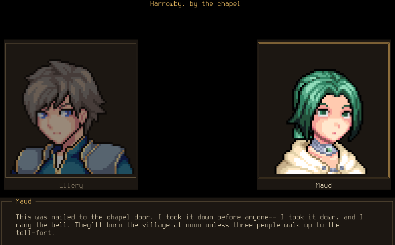

The opening intro: the title screen plays a cinematic cut to the title song, made from the game's own Chapter 1 battle.

## What it is

A turn-based tactics game in the spirit of Fire Emblem. You play it entirely
from the keyboard or a controller: a cursor on the map, the arrow keys and
the home row by default or a mirrored left-handed layout, one hand steering
and one hand acting. Every key and button can be rebound.

- **Setting and tone:** a medieval fantasy war between European-style
  kingdoms, in a world with other continents that feel different. Dark, with
  warmth and humor in between (think *Path of Radiance* and *Triangle
  Strategy*). It ends in a hard-fought victory, not a tragedy.
- **Your lead:** a disgraced, exiled young noble, with a gender and a name
  you choose and a class line of their own.
- **Battles:** weapon durability and Combat Arts, spells that set forests on
  fire or freeze rivers, class skills, four weights of armor, and a limited
  number of turn rewinds per map. Maps to rout, seize, escape or defend a
  village. Classic mode (fallen units are gone) or Casual.
- **Between battles:** a world map in the style of *The Sacred Stones*, with
  towns and their shops, a camp, side quests and skirmishes; level ups and
  promotions; supports earned by fighting side by side; and dialogue scenes
  with two portraits over the place where the talk happens.
- **Two looks:** hand-made pixel art (portraits, map tiles, unit sprites
  that walk, a close-up combat scene), or colored glyphs like Dwarf
  Fortress or Rogue, where the game began. Options switches between them.

<table>
<tr>
<td width="50%">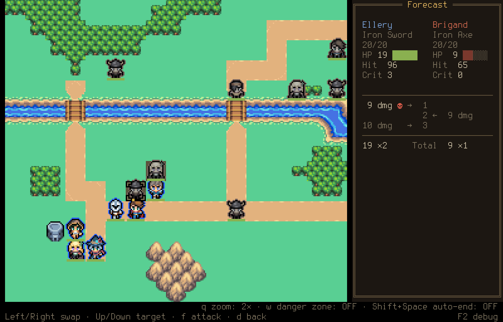</td>
<td width="50%">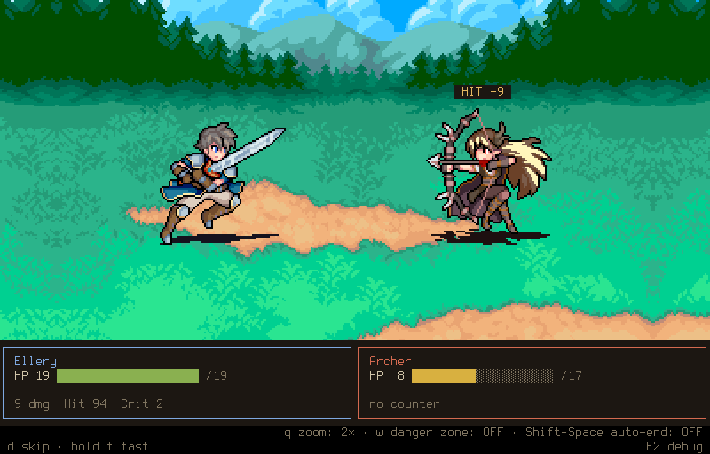</td>
</tr>
<tr>
<td align="center">The forecast before an attack</td>
<td align="center">The close-up combat scene</td>
</tr>
<tr>
<td width="50%">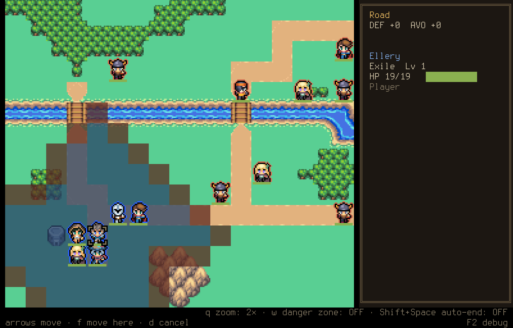</td>
<td width="50%">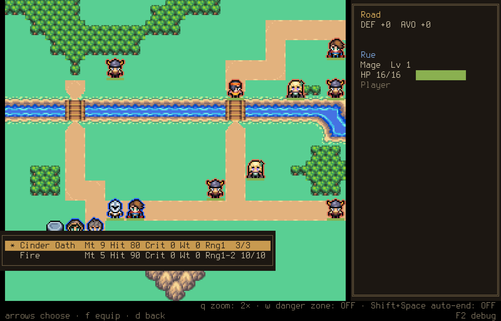</td>
</tr>
<tr>
<td align="center">Move and attack ranges</td>
<td align="center">Spells</td>
</tr>
<tr>
<td width="50%">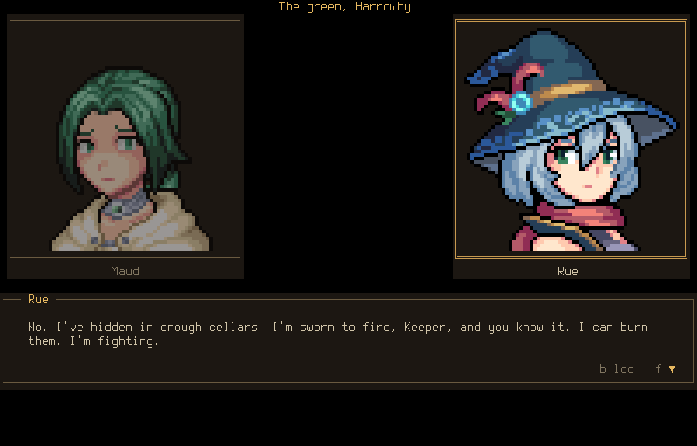</td>
<td width="50%">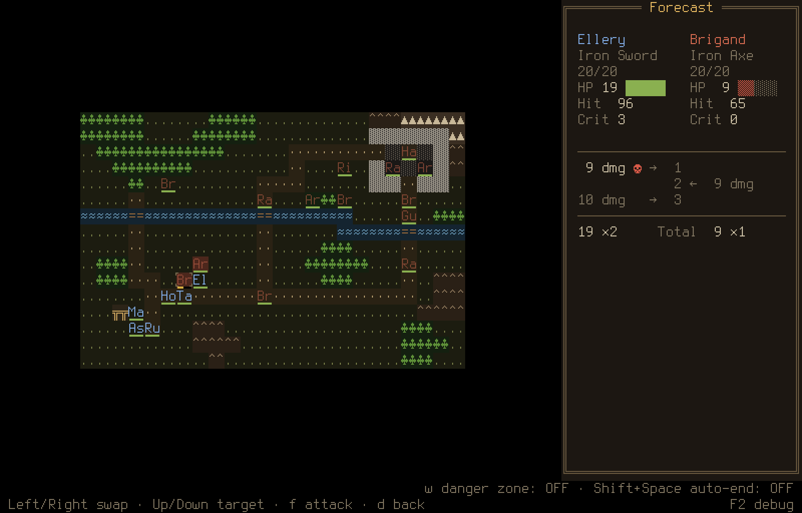</td>
</tr>
<tr>
<td align="center">Dialogue scenes</td>
<td align="center">The glyph look: the same moment as the first picture</td>
</tr>
</table>

The pictures are screenshots of Chapter 1 in the game. The pixel art
was bought and its files are not part of this repository.

## What you can play today

**Pre-alpha.** The [browser build](https://zafnok.github.io/visions-of-shuyi/)
is rebuilt after every change. **New Game** plays the first five chapters of
Act 1:

- **Chapters 1 to 3** run one after another: scenes, a battle, more
  scenes. New Game asks how familiar you are with games like this, and in
  Chapter 1 a guide, Vix, teaches by doing: tips as new things come up,
  lessons to tick off, and Guides to read again from the battle menu.
  Chapter 1's lines are voiced, and so is Vix.
- **From Chapter 4** the army travels a world map: towns with an armory, a
  vendor, an alchemist, a tailor and a blacksmith; a camp; random
  skirmishes; and the first two side quests, which open only while a
  certain companion lives.
- After **Chapter 5** the game says "To be continued".

In a battle you can:

- move units with the cursor, see move and attack ranges, the enemy danger
  zone and which enemies can reach the tile you are moving to, and read
  terrain and unit info;
- attack with a full forecast (hit, crit, damage, doubling, counters) and
  watch the exchange in the close-up combat scene;
- cast spells, including ones that burn forest or freeze water, and point
  at a wounded ally to heal them;
- use Combat Arts (stances that react, strikes that hit several units,
  disarms) and class skills, potions and gear, special weapons, and swap
  weapons;
- shop before a battle on the Preparations screen;
- rewind a turn when a move goes wrong, and on Game Over too while you have
  rewinds left;
- fight enemies and bosses that use arts, stances and skills, and raiders
  who burn the houses you are trying to save;
- earn EXP and level up;
- trigger dialogue on the battlefield: boss lines, last words, and *Talk*;
- zoom the map in and out, and read back earlier lines in the dialogue log.

Around the battles: player profiles, each with its own options, keys and
saves; saving and loading (with a suspend save in the middle of a battle);
an options menu with color themes, the tutorial's level and voices on or
off; rebinding for keys and controller buttons; a credits screen; music
and sound throughout. Leave the title screen alone for 15 seconds and it
plays the intro cinematic above, in time with the title music.

The build also has a **Quick Battle** on the title screen, a test battle
for checking changes.

<table>
<tr>
<td width="33%">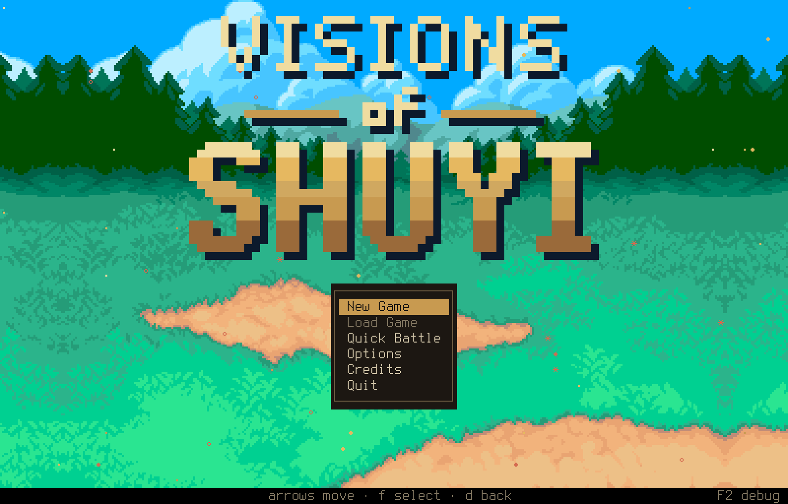</td>
<td width="33%">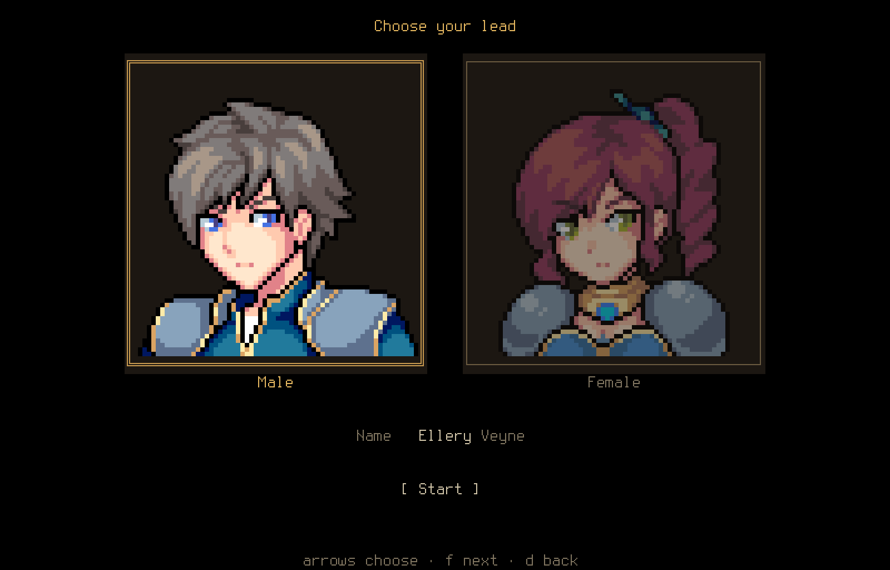</td>
<td width="33%">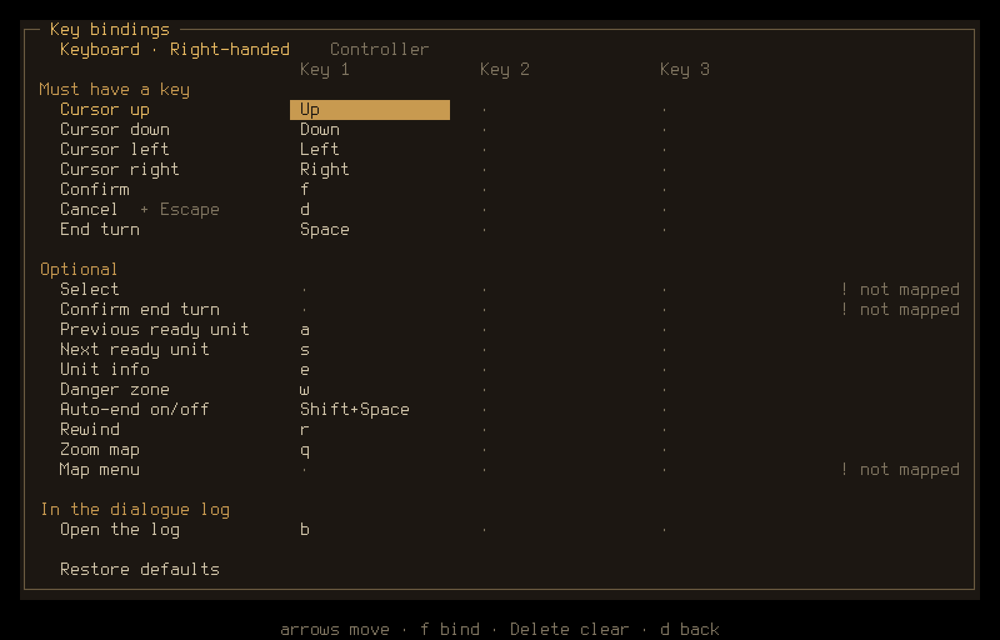</td>
</tr>
<tr>
<td align="center">The title screen</td>
<td align="center">Choosing your lead</td>
<td align="center">Rebinding keys and buttons</td>
</tr>
</table>

**Not in yet:**

- Chapters 6 to 8's battles and the end of Act 1 (their scripts are
  drafted).
- Three more side quests, the eight fixed skirmishes, and support
  conversations and camp events.
- Promoting and changing class between battles.
- Faces and close-up pictures for the cast who join after Chapter 1, and
  for mounted units (stand-ins for now).
- Voices after Chapter 1.
- Chapter title cards and transitions between screens.

### Progress

*As of 2026-11-09. Work is tracked as tickets in [`tickets/`](tickets/README.md);
the numbers below count finished tickets out of all tickets written so far.*

| Act 1 | Done |
| ----- | ---: |
| Chapter scripts drafted | 8 / 8 |
| Chapter battles built | 5 / 8 |
| Side quests | 2 / 5 |
| Fixed skirmishes | 0 / 8 |
| Chapters voiced | 1 / 8 |

| Area | Progress | Done |
| ---- | -------- | ---: |
| Game-design decisions | `████████████░░░░░░░░` | 52 / 84 |
| Project foundation | `██████████████░░░░░░` | 39 / 54 |
| Drawing, input and audio | `██████████████████░░` | 48 / 52 |
| Battle rules | `██████████████████░░` | 30 / 34 |
| Battle screens | `███████████████░░░░░` | 67 / 91 |
| Enemy AI and playtest bots | `███████████████░░░░░` | 21 / 28 |
| Level ups and classes | `██████████████░░░░░░` | 7 / 10 |
| Story and dialogue | `███████████████░░░░░` | 48 / 66 |
| Chapters and game flow | `██████████████░░░░░░` | 50 / 70 |
| Release | `████████████░░░░░░░░` | 8 / 13 |
| World map and later plans | `████░░░░░░░░░░░░░░░░` | 9 / 44 |
| Playdate version | `████████████░░░░░░░░` | 27 / 46 |
| Shuyi Engine and tooling | `███████████░░░░░░░░░` | 67 / 126 |
| **Total** | `█████████████░░░░░░░` | **473 / 718** |

Many open tickets are for things planned after Act 1 (other languages,
modding, replay modes), which is why the bars look emptier than Act 1
really is. Shuyi Engine's own tickets are counted in
[its repository](https://github.com/Zafnok/shuyi-engine), not here.

## Roadmap

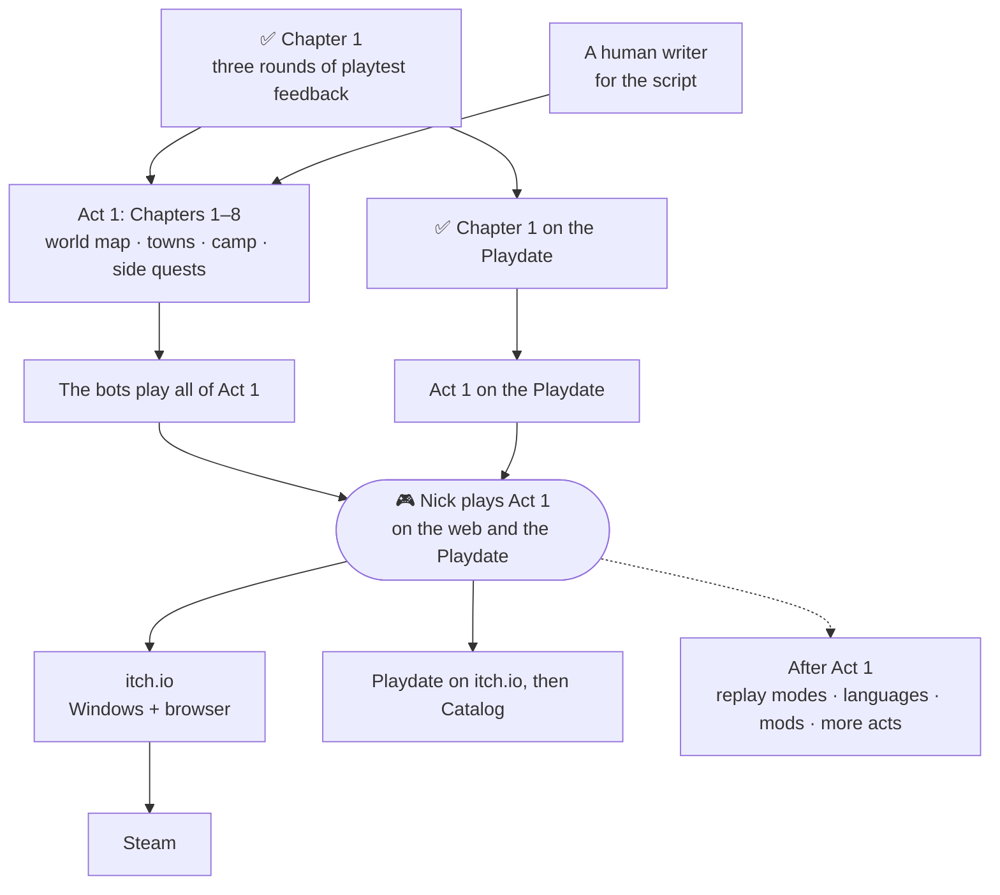

### Now: Act 1

Act 1 is eight chapters, and it ends with one playtest of the whole act by
Nick, on the web and on his Playdate. Before that:

1. **The rest of the act:** Chapters 6 to 8's battles, the act's closing
   scene, the remaining side quests and the fixed skirmishes.
2. **Two playtests of the Act 1 build** (a friend's, and Nick's on
   2026-11-08) became tickets: an easier-to-read forecast and stats, the
   objective shown when a battle starts, some units weaker or stronger,
   enemies that close in instead of waiting, and more.
3. **A human writer.** The script is drafted for all eight chapters, but
   it will be rewritten by a person: no new dialogue is written until a
   writer is found. A script preview that runs without the game's tools,
   and a guide for an outside writer, come first.
4. **The bots play all of Act 1** as a Casual, a Normal and a Hardcore
   player: no softlocks, every battle inside its balance bands, and a save
   and load at every stop.

The full plan, in dependency order, is in
[`docs/ROADMAP.md`](docs/ROADMAP.md) (*Act 1 critical path*).

### Then: release

itch.io first (Windows, Linux, macOS and the browser), then Steam.

### Alongside: the Playdate version

A version for [Playdate](https://play.date), the small handheld with a
one-bit screen and a crank. Chapter 1 already runs on the device, and Nick
has played it there: the glyph look in black and white with information in
the corners (as in Fire Emblem on the Game Boy Advance), the D-pad, A and B,
and **the crank, wound backwards, rewinds the battle**. Music, sounds,
one-bit portraits, a simple combat picture and the title cinematic are all
in ([`playdate.md`](docs/design/playdate.md)). Next it gets the world map,
the camp and the new cast, and loads one chapter at a time so all eight
fit. It will be sold on itch.io first, then on Playdate's Catalog.

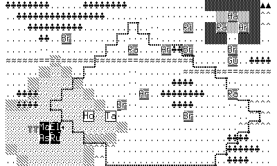

The mockup Nick chose for the Playdate screen, at its real size
(400 × 240).

It shares the game's code, and nothing in the Windows or browser game
waits for it.

### Shuyi Engine

The parts of this code that aren't about this game (drawing, input,
audio, screens, cinematics, the turn-based grid kit, the playtest bots and
the testing tools) are **Shuyi Engine**, an open-source 2D engine under
MIT or Apache-2.0, at
[`Zafnok/shuyi-engine`](https://github.com/Zafnok/shuyi-engine). The game
is built on it, pinned to one of its commits (`shuyi-engine.rev`), and a
watcher on the engine asks for the pin to move when its API changes. How the two work together
is in [`docs/engine/`](docs/engine/README.md).

### Planned after Act 1

- **Reasons to replay:** star ratings with optional challenges on each
  battle, and optional "Visions" that trade a drawback for a reward on
  random skirmishes.
- **Extra modes:** Ironman, a roguelike run mode with its own saves, and a
  randomizer.
- **Replays and sharing:** watch a battle back, or compare yourself with a
  veteran's run.
- **Other languages:** Japanese and Simplified Chinese.
- **Modding:** a mods folder, a map editor, and player-made campaigns.
- **More game:** more acts and continents, higher class tiers, and
  difficulty modes.
- **Multiplayer**, after the single-player game is out.

The voices and translations are machine-made at first and built so that
people can replace them later; the game will say which parts are
machine-made, and Options turns voices off.

## How it's built

It is written in Rust and runs as a Windows program and in the browser from
the same code, with Linux and macOS builds and a Playdate build from the
same rules. The rules of the game are kept separate from how it looks,
which is what makes turn rewind, the two looks and the Playdate version
possible. It is also what lets **playtest bots** play every battle as a
Casual, a Normal and a Hardcore player: their results are checked against
bands for each battle, and CI plays them again whenever a balance number
changes.

| Where | What |
| ----- | ---- |
| [`tickets/`](tickets/README.md) | The backlog. Each ticket is a Markdown file; finished ones move to `tickets/done/` |
| [`docs/ROADMAP.md`](docs/ROADMAP.md) | Milestones and the path to the Act 1 playtest |
| [`docs/design/`](docs/design/README.md) | Game-design decisions, made by Nick |
| [`docs/story/`](docs/story/README.md) | Story beats, bible and characters (spoilers!) |
| [`docs/adr/`](docs/adr/README.md) | Technical decisions |
| [`docs/engine/`](docs/engine/README.md) | How the game works with Shuyi Engine |
| [`docs/targets.md`](docs/targets.md) | Each platform's performance budgets and the benchmarks that hold them |
| [`docs/releasing.md`](docs/releasing.md) | How a release is cut |
| [`crates/`](crates) | The code |
| [`AGENTS.md`](AGENTS.md) + [shared skills](.claude/skills) + [Codex loaders](.agents/skills) | Instructions for the AI sessions that build the game |

## License

**Source-available, not open source.** Copyright (c) 2026 Nick Wentz, all
rights reserved. You may read and learn from the code, use it in
non-commercial teaching, make free non-commercial mods, and stream or post
videos of the game (monetized is fine). You may not redistribute or sell it or
games made from it. See [`LICENSE`](LICENSE) for the exact terms, and
[`THIRD_PARTY_ASSETS.md`](THIRD_PARTY_ASSETS.md) for third-party material.
Shuyi Engine, in its own repository, is open source under its own license
(MIT or Apache-2.0).
