

# Visions of Shuyi

**A tactical RPG you can play entirely from the keyboard.**
*Fire Emblem's battles, a roguelike's glyphs or pixel art, a text editor's hands.*

[**▶ Play the latest build in your browser**](https://zafnok.github.io/visions-of-shuyi/)
&nbsp;·&nbsp; [Roadmap](docs/ROADMAP.md)
&nbsp;·&nbsp; [Backlog](tickets/README.md)
&nbsp;·&nbsp; [Design decisions](docs/design/README.md)

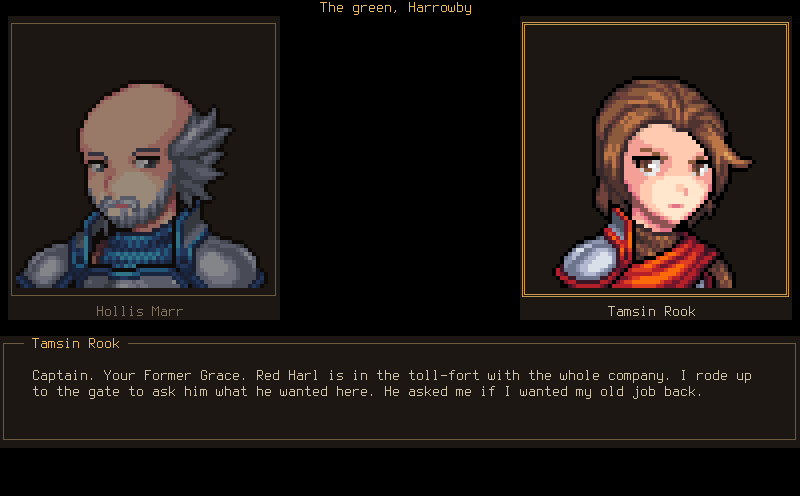

The opening intro: the title screen plays a cinematic cut to the title song, made from the game's own Chapter 1 battle.

## What it is

A turn-based tactics game in the spirit of Fire Emblem. You play it entirely
from the keyboard (or a controller): a cursor on the map, vim-style movement
by default or a left-handed layout, one hand steering and one hand acting.
Every key and button can be rebound.

- **Setting and tone:** a medieval fantasy war between European-style
  kingdoms, in a world with other continents that feel different. Dark, with
  warmth and humor in between (think *Path of Radiance* and *Triangle
  Strategy*). It ends in a hard-fought victory, not a tragedy.
- **Your lead:** a disgraced, exiled young noble, with a gender and a name
  you choose and a class line of their own.
- **Battles:** weapon durability and Combat Arts, spells that set forests on
  fire or freeze rivers, class skills, and a limited number of turn rewinds
  per map. Classic mode (fallen units are gone) or Casual.
- **Between battles:** level ups, promotions and class changes, supports
  earned by fighting side by side, and dialogue scenes with two portraits on
  screen.
- **Two looks:** hand-made pixel art (portraits, map tiles, unit sprites
  that walk, a close-up combat scene), or colored glyphs like Dwarf
  Fortress or Rogue, where the game began. Options switches between them.

<table>
<tr>
<td width="50%">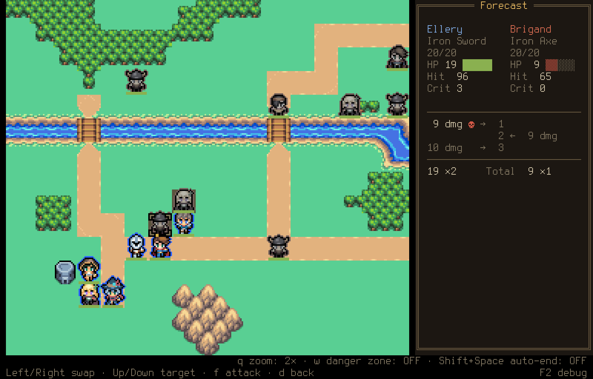</td>
<td width="50%">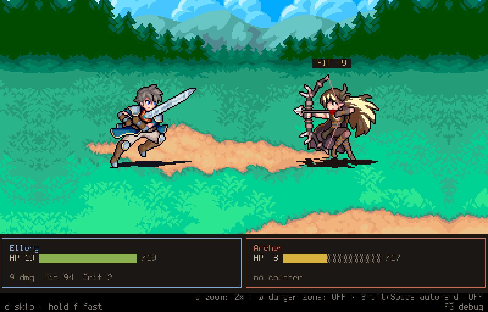</td>
</tr>
<tr>
<td align="center">The forecast before an attack</td>
<td align="center">The close-up combat scene</td>
</tr>
<tr>
<td width="50%">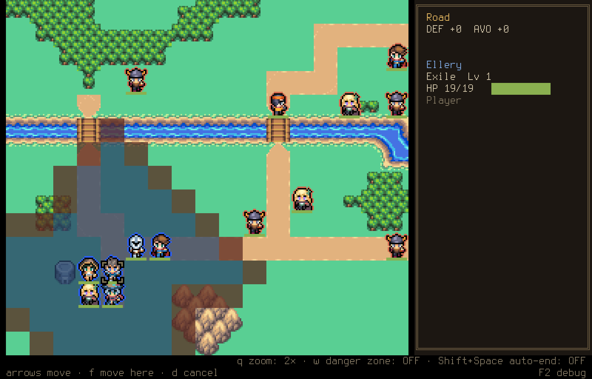</td>
<td width="50%">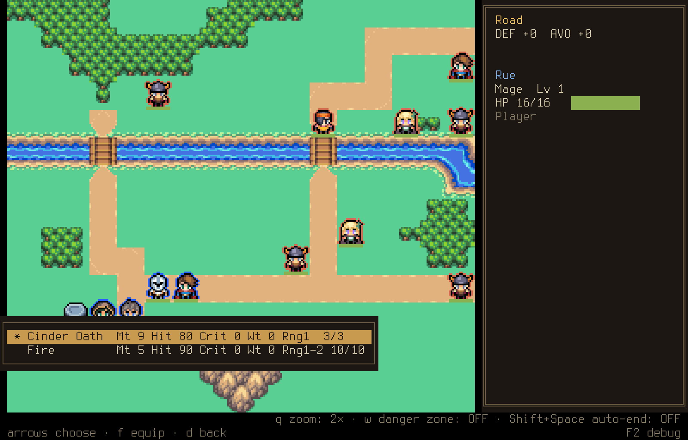</td>
</tr>
<tr>
<td align="center">Move and attack ranges</td>
<td align="center">Spells</td>
</tr>
<tr>
<td width="50%">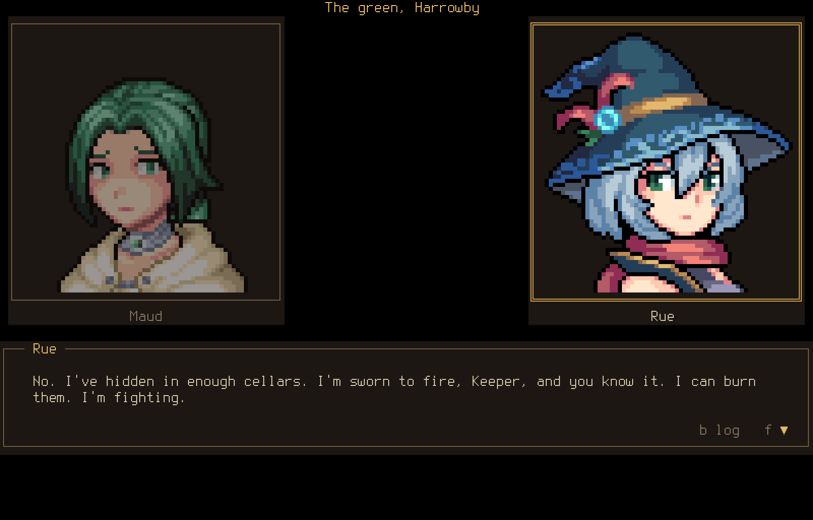</td>
<td width="50%">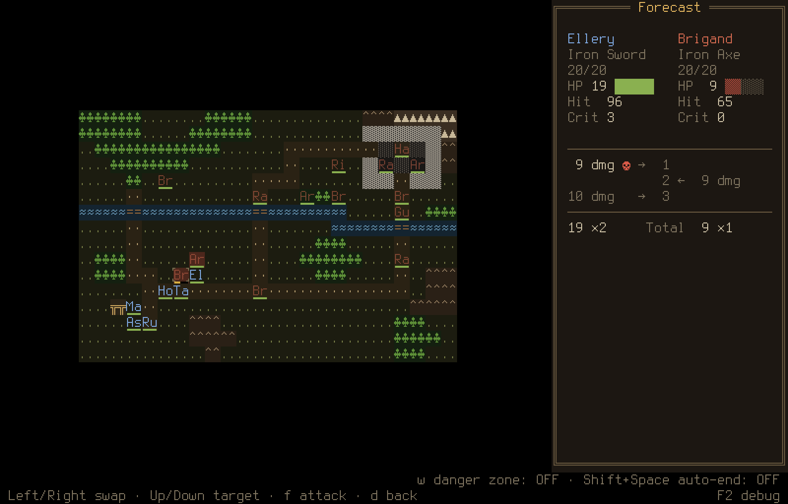</td>
</tr>
<tr>
<td align="center">Dialogue scenes</td>
<td align="center">The glyph look: the same moment as the first picture</td>
</tr>
</table>

The pictures are screenshots of Chapter 1 in the game. The pixel art
was bought and its files are not part of this repository.

## What you can play today

**Pre-alpha.** The [browser build](https://zafnok.github.io/visions-of-shuyi/)
is rebuilt after every change. It has two ways in:

- **New Game** plays Chapter 1: pick Classic or Casual, say how familiar
  you are with games like this, pick and name your lead, watch the opening
  scene, fight the chapter's battle with six units, see the results, save,
  and carry on.
- **Quick Battle** drops you into a test battle through the Preparations
  screen.

Leave the title screen alone for 15 seconds and it plays the intro
cinematic above, in time with the title music.

In a battle you can:

- move units with the cursor, see move and attack ranges, the enemy danger
  zone and which enemies can reach the tile you are moving to, and read
  terrain and unit info;
- attack with a full forecast (hit, crit, damage, doubling, counters) and
  watch the exchange in the close-up combat scene;
- cast spells, including ones that burn forest or freeze water, and point
  at a wounded ally to heal them;
- use Combat Arts and class skills (each described as you choose them),
  potions and gear, and swap weapons;
- rewind a turn when a move goes wrong, and on Game Over too while you have
  rewinds left;
- fight enemies that fight back, with a boss that uses arts and skills, and
  watch their turn play out;
- earn EXP, level up, promote and change class;
- trigger dialogue on the battlefield: boss lines, last words, and *Talk*;
- zoom the map in and out, and read back earlier lines in the dialogue log.

Around the battles there is saving and loading (with a suspend save in the
middle of a battle), an options menu with color themes, rebinding for keys
and controller buttons, a credits screen, victory and defeat music, a Game
Over animation, and music and sound throughout.

<table>
<tr>
<td width="33%">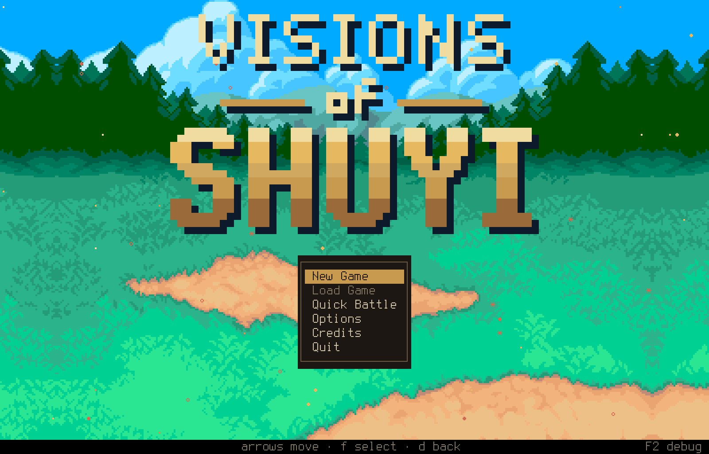</td>
<td width="33%">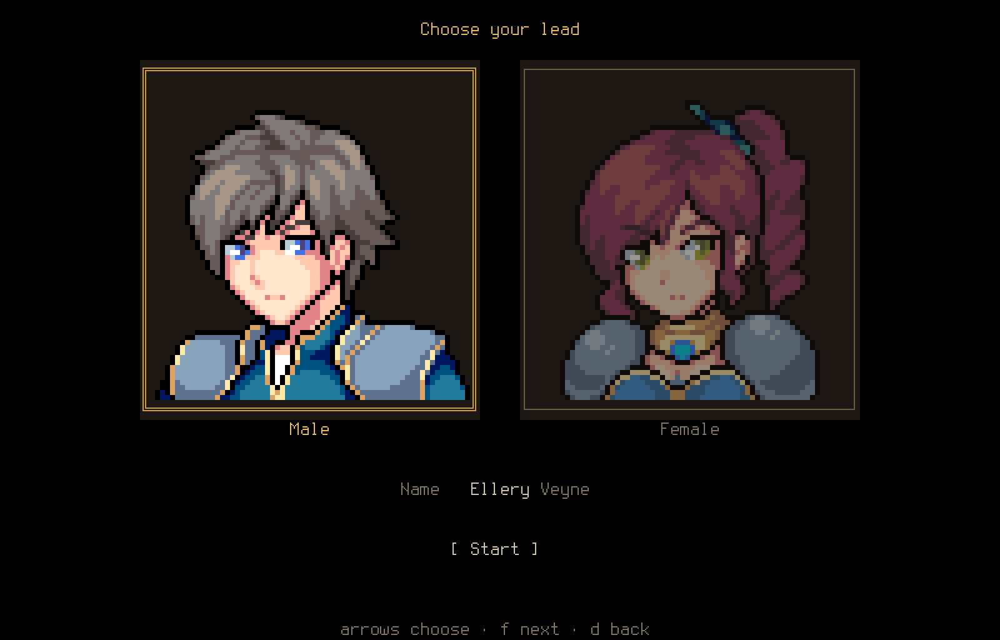</td>
<td width="33%">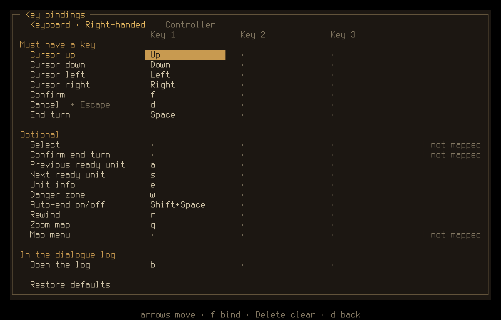</td>
</tr>
<tr>
<td align="center">The title screen</td>
<td align="center">Choosing your lead</td>
<td align="center">Rebinding keys and buttons</td>
</tr>
</table>

**Not in yet:**

- The tutorial: a guide who shows up with tips, lessons to tick off in
  Chapter 1, and Guides to read in the battle menu.
- Player profiles, each with its own options and saves.
- Moving scenes behind conversations.
- The close-up picture for mounted units (a stand-in for now).
- Shops and villages on the map.

### Progress

*As of 2026-10-15. Work is tracked as tickets in [`tickets/`](tickets/README.md);
the numbers below count finished tickets out of all tickets written so far.*

| Area | Progress | Done |
| ---- | -------- | ---: |
| Game-design decisions | `███████████░░░░░░░░░` | 35 / 62 |
| Project foundation | `██████████████████░░` | 23 / 25 |
| Drawing, input and audio | `█████████████████░░░` | 41 / 47 |
| Battle rules | `███████████████████░` | 15 / 16 |
| Battle screens | `████████████████░░░░` | 45 / 58 |
| Enemy AI and playtest bots | `█████████░░░░░░░░░░░` | 5 / 11 |
| Level ups and classes | `██████████████░░░░░░` | 5 / 7 |
| Story and dialogue | `██████████████░░░░░░` | 22 / 31 |
| Chapter 1 and game flow | `███████████████░░░░░` | 29 / 39 |
| Release | `█████████░░░░░░░░░░░` | 3 / 7 |
| After Chapter 1 | `█░░░░░░░░░░░░░░░░░░░` | 1 / 24 |
| Playdate version | `█░░░░░░░░░░░░░░░░░░░` | 2 / 29 |
| Shuyi Engine | `██░░░░░░░░░░░░░░░░░░` | 2 / 19 |
| **Total** | `████████████░░░░░░░░` | **228 / 375** |

The bars look emptier than Chapter 1 really is: many of the open tickets
are for things planned after it (other languages, voices, modding, the
world map), and the Playdate and engine rows are new lines of work that
started this week. Shuyi Engine's own tickets are counted in
[its repository](https://github.com/Zafnok/shuyi-engine), not here.

## Roadmap

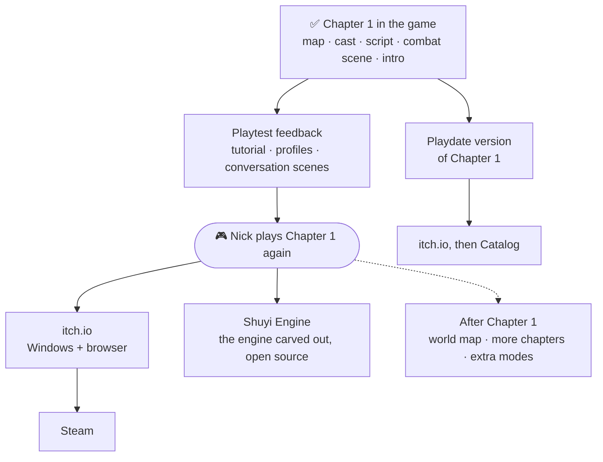

### Now: playtest feedback on Chapter 1

Chapter 1 is in the game, and Nick has played it twice. Each round's
comments became tickets; the third round is waiting for:

1. **A tutorial.** New Game already asks how familiar you are; next come
   a guide whose face appears with the tips, lessons to tick off in
   Chapter 1, and Guides to read again from the battle menu.
2. **Player profiles** on the title screen, each with its own options
   and saves, and Options asking before it keeps your changes.
3. **Moving scenes behind conversations**, with the portraits over them.
4. **Smaller touches:** a softer face for one of the cast, and the range
   of one spell.
5. **Nick plays it again**, over and over, until the feel is right.

### Then: release

itch.io first (Windows and browser), then Linux and macOS builds, then
Steam.

### Alongside: Chapter 1 on the Playdate

A version of Chapter 1 for [Playdate](https://play.date), the small
handheld with a one-bit screen and a crank. A technical test already runs
the game's rules on the device: an enemy turn with 14 enemies thinks for
1.2 seconds. Nick decided how it looks and plays
([`playdate.md`](docs/design/playdate.md)):

- the glyph look in black and white: the map fills the screen and
  information pops up in the corners, as in Fire Emblem on the Game Boy
  Advance;
- your units in black, enemies in grey;
- the D-pad, A and B, with both buttons together to end the turn, and
  **the crank, wound backwards, rewinds the battle**;
- music, sounds, one-bit portraits, a simple combat picture and the title
  cinematic all kept;
- sold on itch.io first, then on Playdate's Catalog.

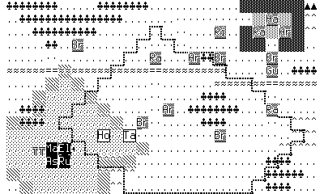

A mockup of the Playdate screen at its real size (400 × 240), from
Nick's choices.

It shares the game's code, and nothing in the Windows or browser game
waits for it.

### Shuyi Engine

The parts of this code that aren't about this game (drawing, input,
audio, screens, cinematics, the testing tools) are now **Shuyi Engine**, a
separate, open-source 2D engine under MIT or Apache-2.0, at
[`Zafnok/shuyi-engine`](https://github.com/Zafnok/shuyi-engine). They were
carved out here one piece at a time, with a small example game made from
the engine alone, and moved there with their history on 2026-10-19. The
game stays paid and is built on it, pinned to one of its commits
(`shuyi-engine.rev`). How the two work together is in
[`docs/engine/`](docs/engine/README.md).

### Planned after Chapter 1

- **A world map** in the style of *The Sacred Stones*: travel between
  places, towns and a camp, with fixed and random skirmishes.
- **Support conversations** between units who fight side by side, and camp
  scenes.
- **Shops, villages to visit and chests** on the battle map.
- **Reasons to replay:** star ratings with optional challenges on each
  battle, and optional "Visions" that trade a drawback for a reward on
  random skirmishes.
- **Extra modes:** Ironman, a roguelike run mode with its own saves, and a
  randomizer.
- **Replays and sharing:** watch a battle back, or compare yourself with a
  veteran's run.
- **Other languages:** Japanese and Simplified Chinese.
- **Voiced dialogue**, with an off switch.
- **More to look at:** chapter title cards and screen transitions.
- **Modding:** a mods folder, a map editor, and player-made campaigns.
- **More game:** more chapters and continents, higher class tiers, and
  difficulty modes.
- **Multiplayer**, after the single-player game is out.

The translations and voices will be machine-made at first and built so that
people can replace them later; the game will say which parts are
machine-made. The full plan, in dependency order, is in
[`docs/ROADMAP.md`](docs/ROADMAP.md).

## How it's built

It is written in Rust and runs as a Windows program and in the browser from
the same code. The rules of the game are kept separate from how it looks,
which is what makes turn rewind, the playtest bots, the two looks and the
Playdate version possible.

| Where | What |
| ----- | ---- |
| [`tickets/`](tickets/README.md) | The backlog. Each ticket is a Markdown file; finished ones move to `tickets/done/` |
| [`docs/ROADMAP.md`](docs/ROADMAP.md) | Milestones and the path to a playable Chapter 1 |
| [`docs/design/`](docs/design/README.md) | Game-design decisions, made by Nick |
| [`docs/story/`](docs/story/README.md) | Story beats, bible and characters (spoilers!) |
| [`docs/adr/`](docs/adr/README.md) | Technical decisions |
| [`docs/engine/`](docs/engine/README.md) | Shuyi Engine: the study, the plan for carving it out, and how the game works with it now |
| [`docs/releasing.md`](docs/releasing.md) | How a release is cut |
| [`crates/`](crates) | The code |
| [`AGENTS.md`](AGENTS.md) + [shared skills](.claude/skills) + [Codex loaders](.agents/skills) | Instructions for the AI sessions that build the game |

## License

**Source-available, not open source.** Copyright (c) 2026 Nick Wentz, all
rights reserved. You may read and learn from the code, use it in
non-commercial teaching, make free non-commercial mods, and stream or post
videos of the game (monetized is fine). You may not redistribute or sell it or
games made from it. See [`LICENSE`](LICENSE) for the exact terms, and
[`THIRD_PARTY_ASSETS.md`](THIRD_PARTY_ASSETS.md) for third-party material.
Shuyi Engine, in its own repository, is open source under its own license
(MIT or Apache-2.0).
